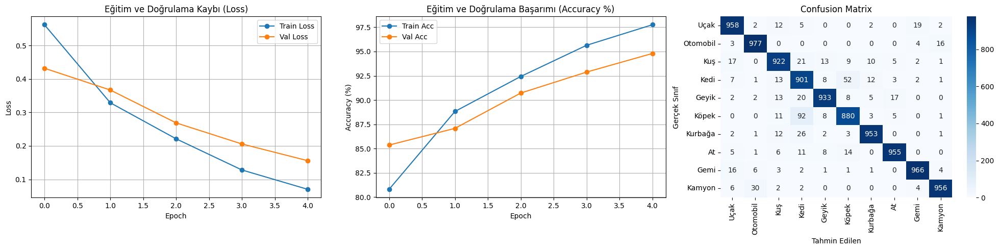
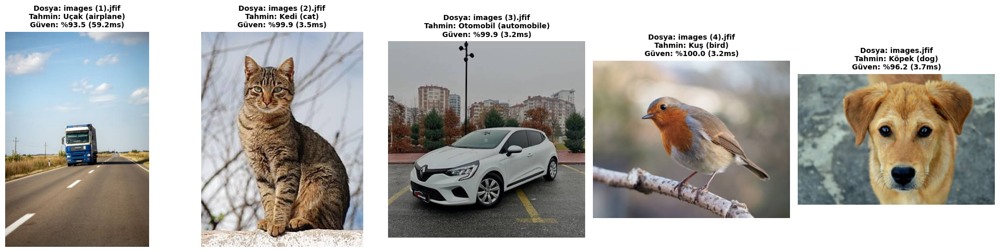

# CIFAR-10 Görüntü Sınıflandırma – ResNet-18 (Transfer Learning) + Gradio

**Hazırlayan:** [YUSUF SAYILGAN] – [24120205061]
**Notebook:** `Untitled9.ipynb` (Google Colab, PyTorch)

---

## 1. Ödevin Amacı

Açık kaynaklı CIFAR-10 veri seti kullanılarak bir görüntü sınıflandırma modeli geliştirmek, modelin başarımını uygun metriklerle değerlendirmek ve modeli Gradio ile çalışan bir web uygulaması olarak sunmak.

## 2. Görev (Task)

**Çok sınıflı görüntü sınıflandırma.** Model, verilen bir görüntüyü 10 sınıftan birine atar:
Uçak, Otomobil, Kuş, Kedi, Geyik, Köpek, Kurbağa, At, Gemi, Kamyon.

## 3. Model (Architecture)

**ResNet-18**, ImageNet üzerinde ön-eğitilmiş ağırlıklarla (`ResNet18_Weights.DEFAULT`) yüklendi (transfer learning).

- Son katman (`fc`) 1000 sınıftan 10 sınıfa değiştirildi: `nn.Linear(512, 10)`.
- Hiçbir katman dondurulmadı; ağın tamamı yeniden eğitildi (fine-tuning).

**Neden ResNet-18?**
- Residual (skip) bağlantılar sayesinde derin ağ kararlı eğitilir.
- ImageNet'ten öğrenilmiş özellikler sayesinde sadece 5 epoch'ta yüksek doğruluğa ulaşılır.
- Yaklaşık 11 M parametresiyle hafif bir modeldir; hem eğitimi hem tahmini hızlıdır.

## 4. Veri Seti (Dataset)

**CIFAR-10**: 10 sınıfa ait 60.000 adet 32×32 boyutunda renkli görüntü.

| Küme | Görüntü Sayısı | Açıklama |
|---|---|---|
| Train | 45.000 | Resmi eğitim kümesinin %90'ı |
| Validation | 5.000 | Resmi eğitim kümesinin %10'u (`random_split`, seed = 42) |
| Test | 10.000 | Resmi test kümesi (sınıf başına 1.000) |

**Ön işleme**
- Görüntüler 128×128'e büyütüldü ve ImageNet ortalama/standart sapma değerleriyle normalize edildi.
- Eğitimde veri artırma uygulandı: `RandomHorizontalFlip` ve `RandomRotation(10)`.

## 5. Model Ayarları ve Eğitim

| Parametre | Değer |
|---|---|
| Learning Rate | 1e-3 (CosineAnnealingLR, T_max = 5) |
| Batch Size | 128 |
| Epoch | 5 |
| Optimizer | AdamW (weight_decay = 1e-4) |
| Aktivasyon (gizli katmanlar) | ReLU |
| Çıkış fonksiyonu | Softmax |
| Loss | Cross-Entropy Loss |

**Seçimlerin kısa gerekçeleri**
- **AdamW:** Öğrenme oranını parametre bazında uyarlar ve hızlı yakınsar. Weight decay'i gradyandan ayrı uyguladığı için Adam'a göre daha iyi düzenlileştirme yapar.
- **Cosine Annealing:** Başta büyük adımlarla öğrenir, son epoch'larda öğrenme oranını küçülterek ince ayar yapar.
- **ReLU:** ResNet'in standart aktivasyonu; hesaplaması ucuzdur ve gradyan sönümlenmesini azaltır.
- **Softmax:** 10 sınıflı çıktıyı toplamı 1 olan olasılıklara çevirir. Bu olasılık, tahminin güven skoru olarak kullanılır.
- **Cross-Entropy:** Çok sınıflı sınıflandırma için standart kayıp fonksiyonudur. PyTorch'ta log-softmax'ı kendi içinde uygular.

**Eğitim sonuçları (epoch bazlı)**

| Epoch | Train Loss | Train Acc | Val Loss | Val Acc |
|---|---|---|---|---|
| 1 | 0.5619 | 80.80% | 0.4319 | 85.36% |
| 2 | 0.3288 | 88.82% | 0.3669 | 87.08% |
| 3 | 0.2211 | 92.43% | 0.2687 | 90.72% |
| 4 | 0.1280 | 95.64% | 0.2057 | 92.88% |
| 5 | 0.0702 | 97.76% | 0.1557 | **94.80%** |

En yüksek doğrulama başarımını veren model (5. epoch) `best_resnet18_cifar10.pth` olarak kaydedildi.

## 6. Performans Değerlendirmesi

**Test kümesi sonuçları (10.000 görüntü, weighted ortalama)**

| Metrik | Değer |
|---|---|
| Accuracy | **94.01%** |
| Precision | 94.10% |
| Recall | 94.01% |
| F1-Score | 94.03% |
| Toplam eğitim süresi | 134.26 s (5 epoch, Colab GPU) |
| Ortalama tahmin süresi | 0.3959 ms / görüntü (GPU, batch 128) |

**Sınıf bazlı sonuçlar**

| Sınıf | Precision | Recall | F1 |
|---|---|---|---|
| Uçak | 0.94 | 0.96 | 0.95 |
| Otomobil | 0.96 | 0.98 | 0.97 |
| Kuş | 0.93 | 0.92 | 0.92 |
| Kedi | 0.83 | 0.90 | 0.87 |
| Geyik | 0.96 | 0.93 | 0.95 |
| Köpek | 0.91 | 0.88 | 0.89 |
| Kurbağa | 0.97 | 0.95 | 0.96 |
| At | 0.97 | 0.95 | 0.96 |
| Gemi | 0.97 | 0.97 | 0.97 |
| Kamyon | 0.97 | 0.96 | 0.96 |

**Yorum**
- **Overfitting yok:** Doğrulama kaybı her epoch düzenli olarak azaldı (0.43 → 0.16). Train ve Val doğruluğu arasındaki fark son epoch'ta yaklaşık 3 puan; bu, hafif ve kabul edilebilir bir genelleme farkıdır. Val (94.80%) ile Test (94.01%) sonuçları da birbirine çok yakın.
- **Confusion Matrix:**
  - En çok karışan çift **Köpek ↔ Kedi**: 92 köpek kedi, 52 kedi köpek olarak tahmin edildi. Kedi sınıfının precision değerinin düşük (0.83) olmasının sebebi budur.
  - Diğer belirgin karışıklıklar: Kamyon→Otomobil (30), Uçak→Gemi (19), Kuş→Uçak (17), Otomobil→Kamyon (16), Gemi→Uçak (16).
  - Bu sınıf çiftleri benzer şekil ya da benzer arka plan (yol, gökyüzü/deniz) paylaşır.

## 7. Uygulama (Deployment)

Model **Gradio** ile web uygulamasına dönüştürüldü (`gr.Interface`).

1. Kullanıcı bir görüntü yükler (`gr.Image`).
2. Görüntü, eğitimdeki ön işlemeyle aynı şekilde (`eval_transform`) hazırlanır: 128×128 boyut ve normalize.
3. Model tahmini yapar ve Softmax ile olasılıklar hesaplanır.
4. En olası 3 sınıf, güven skorlarıyla gösterilir (`gr.Label(num_top_classes=3)`).

Uygulama Colab'da `demo.launch(share=True)` ile çalıştırıldı ve geçici bir public link (`*.gradio.live`) üzerinden erişildi.

> [GRADIO EKRAN GÖRÜNTÜSÜNÜ `images/gradio.png` OLARAK EKLEYİN]

## 8. Gerçek Görüntülerle Test ve Değerlendirme

5 gerçek fotoğraf modele verildi:

| # | Gerçek Sınıf | Tahmin | Güven | Süre | Sonuç |
|---|---|---|---|---|---|
| 1 | Kamyon | Uçak | %93.5 | 59.2 ms | ❌ |
| 2 | Kedi | Kedi | %99.9 | 3.5 ms | ✅ |
| 3 | Otomobil | Otomobil | %99.9 | 3.2 ms | ✅ |
| 4 | Kuş | Kuş | %100.0 | 3.2 ms | ✅ |
| 5 | Köpek | Köpek | %96.2 | 3.7 ms | ✅ |

**Doğruluk: 4/5**

**Başarılı durumlar**
- Kedi, otomobil ve kuş fotoğraflarında nesne kadrajın merkezinde, büyük ve net. Arka plan da sade ya da bulanık; bu yüzden model %99.9–100 güvenle doğru tahmin yaptı.
- Köpek fotoğrafı çok yakın plan (sadece yüz). CIFAR-10'daki köpek görüntüleri genellikle daha uzaktan çekilmiş olduğu için güven skoru diğerlerinden biraz düşük kaldı (%96.2), ama tahmin doğru.

**Başarısız durum: Kamyon → Uçak**
- Fotoğrafın büyük kısmı **mavi gökyüzü ve bulutlardan** oluşuyor; kamyon ise kadrajda küçük kalıyor.
- CIFAR-10'daki uçak görüntülerinin çoğu mavi gökyüzü arka planına sahip. Model nesnenin kendisinden çok **arka plana** bakarak karar vermiş.
- Ayrıca dikey fotoğraf 128×128'e sıkıştırılırken oranları bozuldu, bu da kamyonu daha da küçülttü.
- Bu sonuç, yüksek güven skorunun (%93.5) her zaman doğru tahmin anlamına gelmediğini gösteriyor.

**Tahmin süresi:** İlk fotoğraftaki 59.2 ms, GPU'nun ilk çalıştırmadaki ısınma (warm-up) süresinden kaynaklanıyor. Sonraki tahminler 3.2–3.7 ms sürdü.

**İyileştirme önerileri**
- `RandomResizedCrop` ile farklı ölçeklerde eğitim yapmak.
- Gerçek fotoğrafları `Resize + CenterCrop` ile oranı bozmadan hazırlamak.
- Daha yüksek çözünürlüklü veri ve daha uzun eğitim kullanmak.

## 9. Proje Raporu Şablonu

| Alan | Açıklama / Öğrenci yanıtı |
|---|---|
| Project Title | ResNet-18 ile CIFAR-10 Görüntü Sınıflandırma ve Gradio Web Uygulaması |
| Problem / Task | Çok sınıflı görüntü sınıflandırma (10 sınıf) |
| Dataset | CIFAR-10 (Train 45.000 / Validation 5.000 / Test 10.000) |
| Dataset URL | https://www.cs.toronto.edu/~kriz/cifar.html |
| Model Architecture | ResNet-18 (ImageNet ön-eğitimli, transfer learning, son katman 512→10) |
| Input Size | 3 × 128 × 128 |
| Hyperparameters | LR = 1e-3 (Cosine Annealing), Batch Size = 128, Epoch = 5, Weight Decay = 1e-4 |
| Optimizer | AdamW |
| Activation / Output Function | ReLU / Softmax |
| Loss Function | Cross-Entropy Loss |
| Evaluation Metrics | Accuracy, Precision, Recall, F1-Score, Confusion Matrix |
| Training Environment | Google Colab, NVIDIA GPU (CUDA), PyTorch |
| Best Performance | Test Accuracy 94.01%, F1-Score 94.03% (Val Acc 94.80%) |
| Inference Time | 0.3959 ms / görüntü (GPU, batch); tek görüntü ≈ 3.5 ms |
| Deployment Technology | Gradio |
| Repository | https://github.com/cyberperfo/computervisiondeeple |
